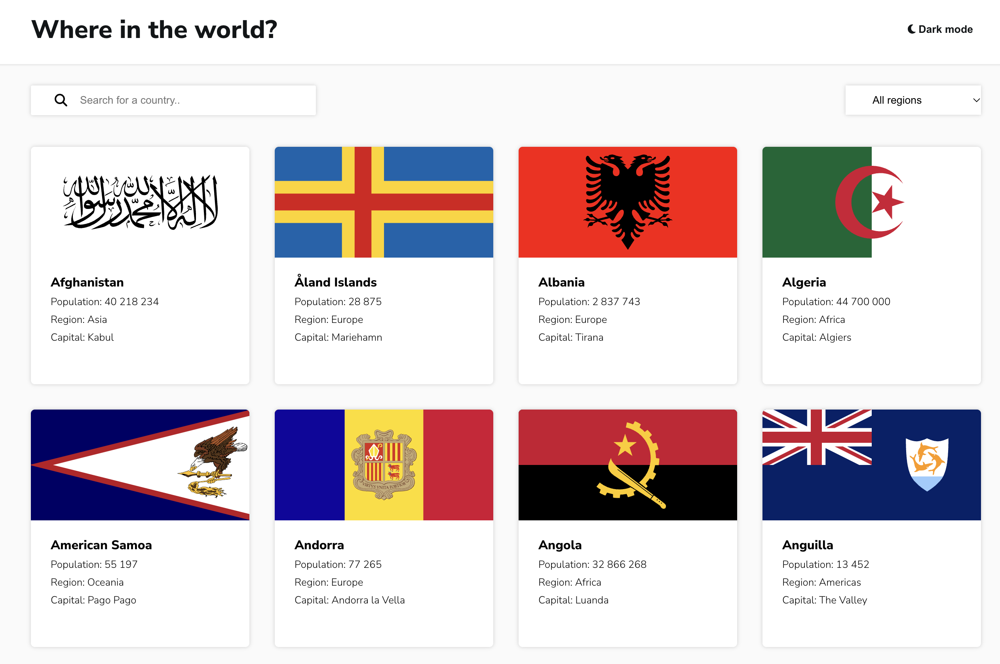

# REST Countries Explorer

A Vue.js application for browsing countries, searching by name, and viewing country details.

Originally built as a practice project focused on working with API data, routing, and interactive UI components.

## Preview



[Live demo](https://petrunenkovas.github.io/restCountries/)

## Features

- Search countries by name
- Filter countries by region
- View country details and navigate to bordering countries
- Switch between light and dark themes

## Tech Stack

- Vue 2
- Vue Router 3 and Vuex 3
- Axios and countries.dev API
- JavaScript, HTML / CSS
- webpack 3

## Technical Highlights

- Fetching and displaying country data from a public API
- Combined search and region filtering
- Dynamic routes for country details and border navigation

## Getting Started

Use Node.js 16 for this legacy webpack setup, then install dependencies and start the development server.

```bash
npm install
npm run dev
```

## Project Status

This is an early learning project that retains its original Vue 2 stack.

The repository is preserved as part of my development history, with small improvements to stability and presentation.
